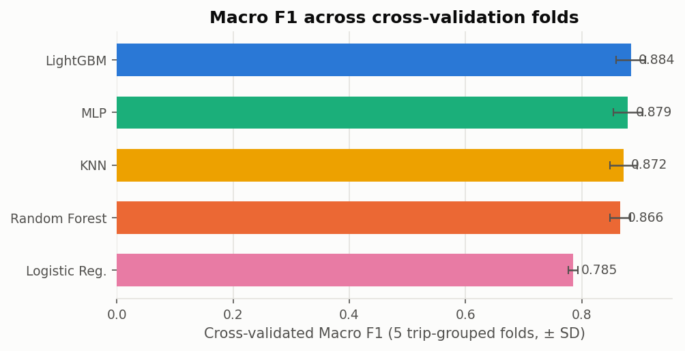
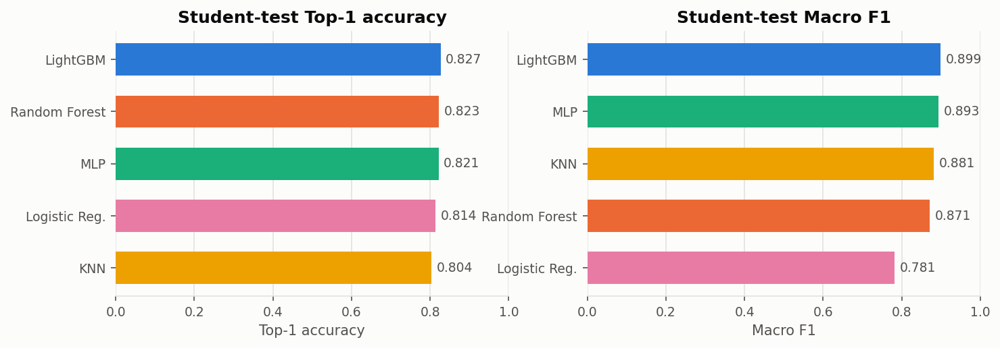
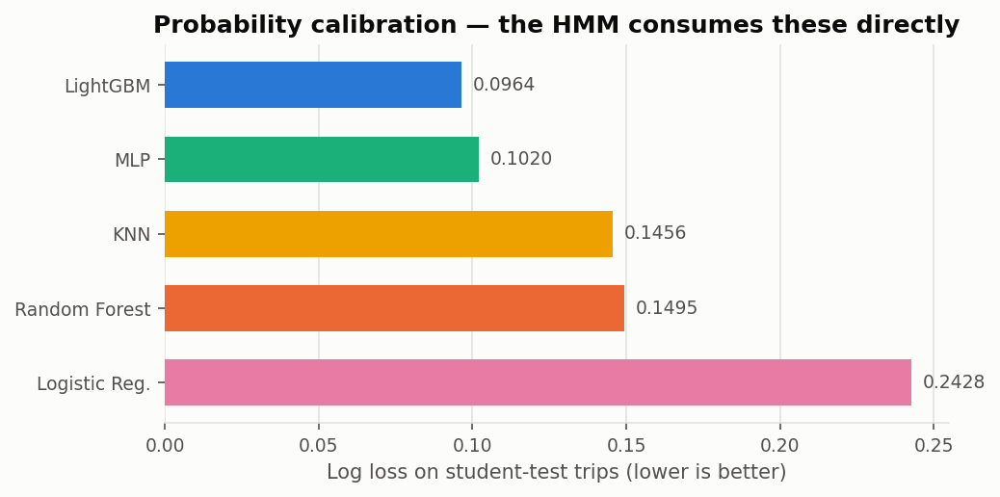
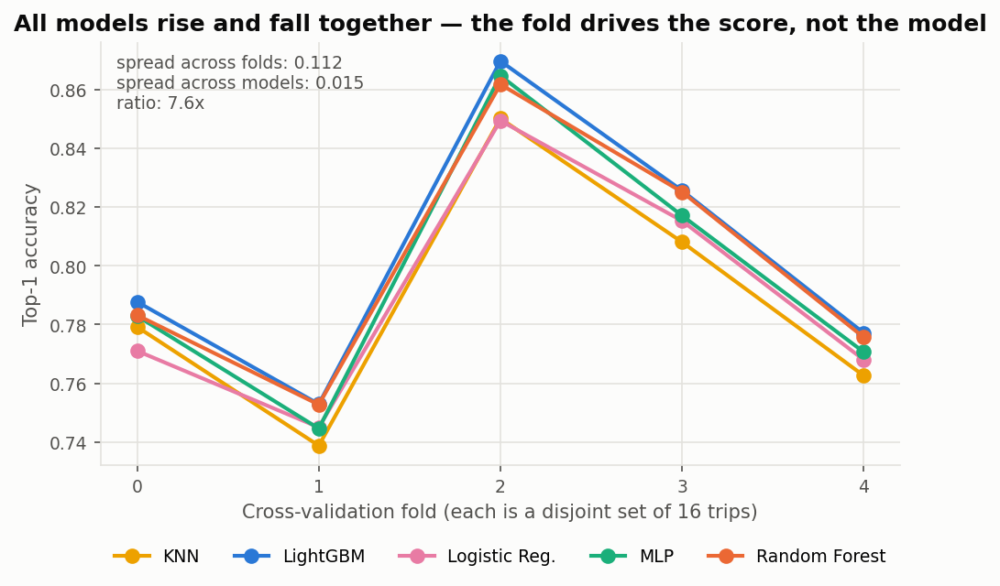
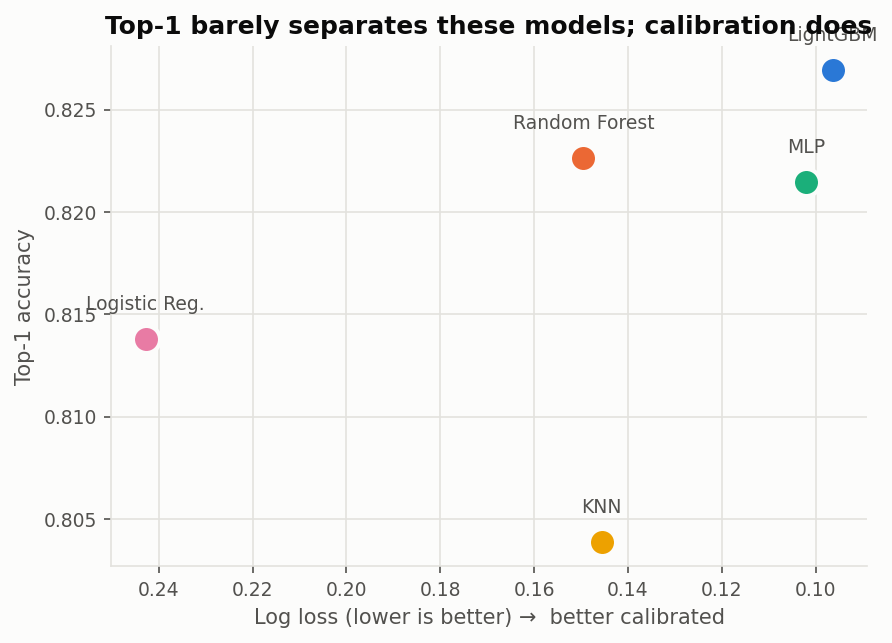
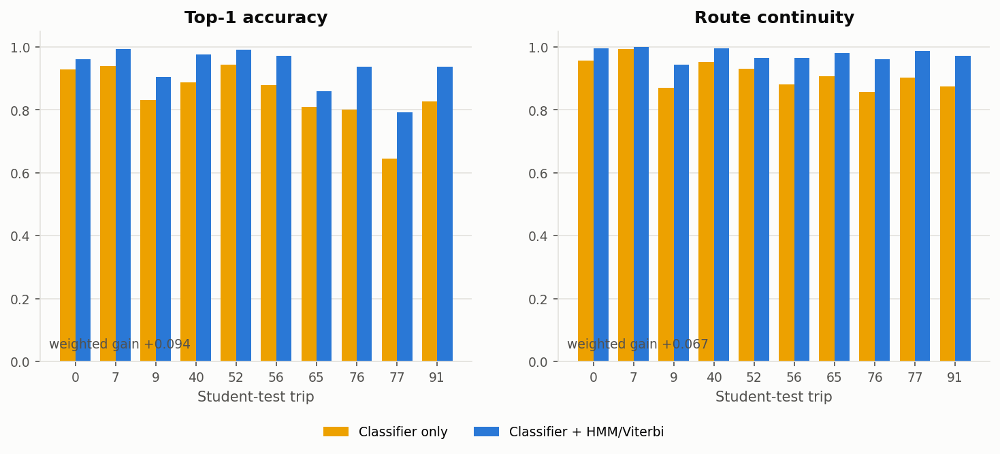
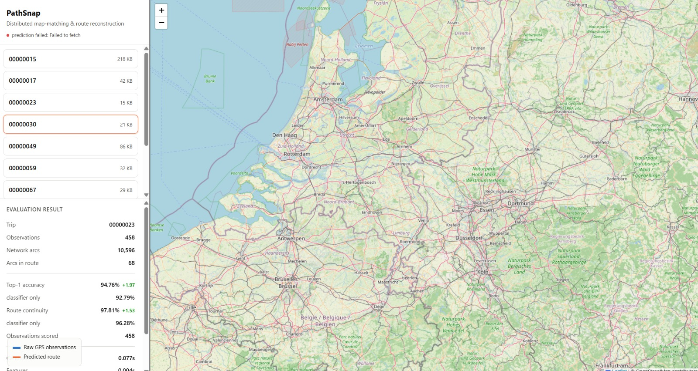

# 1. Overview

PathSnap reconstructs vehicle trajectories by matching noisy GPS observations to a
road network. The system has two stages: a classifier that scores candidate road
segments for each GPS observation, and a Hidden Markov Model decoded with Viterbi
that turns those independent per-observation guesses into a physically connected
route.

**Headline result.** On the ten student-test trips, HMM decoding raised Top-1
accuracy from **0.8300 to 0.9238** (+0.0937) and route
continuity from **0.9132 to 0.9802** (+0.0670), improving
Top-1 on 10 of 10 trips and degrading none.

**Repository:** <https://github.com/Krish-Arun/hackathon_ml>

All results in this report are generated from the committed result files by
`scripts/make_report.py`; nothing is typed in by hand. Code version: `dd39d14`.

# 2. Dataset Understanding and Exploratory Data Analysis

## 2.1 How the data is organised

Each trip ships four whitespace-separated files with no headers.

| File | Columns | Note |
|---|---|---|
| `.nodes` | lon, lat | row index **is** the node id |
| `.arcs` | from_node, to_node | row index **is** the arc id; arcs are **directed** |
| `.track` | lon, lat, timestamp | GPS observations, nominally 1 Hz |
| `.route` | arc_id | ground-truth arcs in travel order |

We verified rather than assumed two properties. Arcs are directed and only ~55% have
a reverse twin, so direction of travel is informative. And consecutive route arcs join
head-to-tail (`to_node[i] == from_node[i+1]`) for 100% of steps, which is what allows
the route to be treated as a walk through a directed graph in section 5.

## 2.2 How we preprocessed the data

**Projection to metres.** The data is in degrees, but one degree of longitude is about
71 km at this dataset's latitude (~50°N) against 111 km at the equator, so Euclidean
distance in degrees is anisotropic. Each trip is projected into a local equirectangular
frame in metres centred on its own network. At a ~50 km extent the error against a full
UTM reprojection is sub-metre — far below GPS noise — at roughly 1% of the cost.

**Point-to-segment distance.** Distances are computed to the nearest point *on* each
arc, with the projection parameter clamped to [0, 1]. Without clamping, an observation
beyond an arc's end would measure against the infinite line through it. We retain the
clamped parameter `t_along` because the HMM needs to know how far along an arc the
vehicle is, not merely which arc.

**Candidate generation.** A trip's network has up to 307,392 arcs, and
the set differs per trip, so direct multi-class classification is not expressible. For
each observation we shortlist the 10 nearest arcs within
200 m and pose a binary question per (observation, candidate)
pair. Candidates are found by sampling every arc at 25 m
intervals into a KD-tree: arc lengths range from 6.7 m (median, shortest trip)
to 9308 m, so a nearest-node search would miss long motorway
arcs whose endpoints are kilometres from an observation in their middle. Exact
point-to-segment distances are recomputed for the shortlist, so sampling affects recall
only, never reported distances.

## 2.3 Missing-value and data-quality analysis

| Check | Result |
|---|---|
| Trips / observations | 90 / 227,577 |
| Missing (NaN) coordinates | **0** |
| Duplicate timestamps | **0** |
| Isolated network nodes | **0** |
| Trips with sampling gaps > 5 s | 47 of 90 |
| Largest single time gap | 153,064 s |
| Network size (arcs) | 649 – 307,392 |
| Median speed | 20 – 148 km/h |
| Nearest arc to an observation | 4.1 m (p50), 13.0 m (p95) |
| Observations with no arc within 200 m | 107 (0.047%) |

The data is clean on the basics — no missing coordinates, duplicate timestamps or
isolated nodes anywhere in the 90 trips. The difficulties are heterogeneity and
irregular sampling. Networks differ by a factor of 474,
median speeds span city crawl to Autobahn, and 47 trips
contain gaps over five seconds. Trip 90 is the extreme case: 536
observations spread over 43 hours with a single
153,064-second gap — effectively two journeys in one file.

The 200 m candidate radius was chosen from the measured
nearest-arc distribution rather than guessed, and excludes only
0.047% of observations.

## 2.4 Deriving per-observation labels

**The dataset does not provide labels in a usable form.** `.route` gives the arcs
traversed in order but not which observation belongs to which arc; across the dataset
there are a median of 5.25 observations per route arc.

Snapping each observation to the nearest route arc fails where a route loops back near
itself or runs beside a parallel carriageway (~15 m away, inside GPS error), because it
ignores time. We instead exploit the one certainty available — the vehicle moved
forward — and solve for the assignment minimising total observation-to-arc distance
subject to route position never decreasing. This is exact dynamic programming over an
(observations × route length) grid:

    dp[i][j] = cost[i][j] + min( dp[i-1][0..j] )

The inner minimum is a prefix minimum, so each row costs one linear scan. The largest
grid in the dataset is 17.9 M cells; keeping a rolling row in float32 holds peak memory
near 140 MB.

**Label validation.** We cannot check derived labels against a ground truth, so we
validate indirectly. Residual distance — how far each observation sits from its
assigned arc — has a median of 4.65 m across trips,
against an independently measured nearest-arc distance of 4.1 m.
The agreement indicates the alignment is selecting arcs the vehicle plausibly occupied;
a scrambled alignment would show residuals of hundreds of metres.

**A genuine data-quality finding.** Validation revealed that some `.route` files
describe only part of the journey the GPS recorded:

| trip_id | n_obs | candidate_recall | frac_label_reliable | label_residual_p50_m |
|---|---|---|---|---|
| 54 | 19,313 | 0.4631 | 0.1057 | 139.2063 |
| 33 | 5,844 | 0.3393 | 0.4114 | 121.6624 |
| 2 | 7,243 | 0.9148 | 0.8934 | 5.7545 |
| 66 | 4,325 | 0.9577 | 0.9101 | 6.5655 |

Trip 33's GPS covers 47.7 km against a 6.4 km reference route (ratio 7.5×); trip 54 is
168.8 km against 31.3 km. We confirmed this is not a coordinate offset — route and track
share the same bounding box, and the discrepancy varies along the trip rather than being
a constant shift. The alignment must still place every observation somewhere, so those
from the uncovered stretch land 120 m+ from their assigned arc.

We therefore flag observations more than 50 m from
their assigned arc as unreliably labelled, justified by the
13.0 m p95 nearest-arc distance. **89.8%** of
observations are reliably labelled and 78 of
90 trips are at least 99% clean. These observations are excluded from *training*
but retained in *evaluation*, so reported scores are not flattered by dropping hard cases.

As the dataset documentation cautions, reference routes should not be assumed to be
error-free ground truth. Our accuracy figures are measured against derived labels and
inherit any systematic bias in the alignment — a limitation we state explicitly rather
than overstate certainty.

## 2.5 Feature engineering

Seventeen features per (observation, candidate) pair, in three groups:

- **Geometry** — `dist_m`, `log_dist`, `t_along`, `arc_length_m`
- **Direction** — `bearing_diff`, `bearing_diff_reverse`, `bearing_rank`. Heading is
  derived from consecutive fixes. Both forward and reversed differences are kept because
  arcs are one-way, and a reversed match typically indicates the opposite carriageway.
- **Relative to the other candidates for the same observation** — `dist_softmax`,
  `dist_rank`, `log_dist_ratio_best`, `dist_minus_best`, `n_candidates`
- **Motion context** — `connected_to_prev_best`, `speed_mps`, `step_dist_m`,
  `dt_prev_s`, `dt_next_s`

The design hypothesis was that *relative* standing beats absolute distance: 30 m from an
arc means little alone, but 30 m when the next best is 400 m is nearly decisive, and 30 m
when three others are within 35 m is ambiguous. Measuring class separation in standard
deviations on the full table confirmed it — `dist_softmax` separates at **1.76 SD** and
`dist_rank` at **1.45**, while raw `dist_m` reaches only **0.92**.

Per-observation context features (`speed_mps`, `t_along`, `dt_*`) separate at ≈0.00, as
expected: they are constant across a candidate group and so cannot discriminate within
one. They are retained only for tree-model conditioning.

**Leakage control.** Every feature is computable from the GPS track and road network
alone; none reads `.route`. The label-quality columns (`label_residual_m`,
`label_reliable`) *are* route-derived and are therefore excluded from `FEATURE_COLUMNS`
and used only as metadata filters.

# 3. Model Experimentation and Comparison

## 3.1 Protocol

Five algorithm families were trained and evaluated, plus the tuned variant from
section 4. Every model used an identical protocol: 5-fold `GroupKFold` grouped by
`trip_id` over the 80 training trips, training rows capped at 200,000 and validation at
100,000 per fold (whole candidate groups only, so Top-1 remains meaningful), then a final
fit scored on the 10 held-out student-test trips. The caps are a compute budget — this
hardware has 2 cores — applied equally to all models so comparison stays fair.

Grouping by trip is essential: observations within a trip are near-duplicates
(consecutive seconds, same roads, same vehicle), so row-wise splitting would let a model
train on near-copies of its validation data. Fold construction asserts no trip appears
on both sides.

## 3.2 Overall comparison

| model | family | cv_macro_f1_mean | cv_top1_mean | test_top1 | test_macro_f1 | test_log_loss | test_route_continuity | inference_us_per_row |
|---|---|---|---|---|---|---|---|---|
| lightgbm | Boosting / gradient-boosted trees | 0.8841 | 0.8026 | 0.8269 | 0.8990 | 0.0964 | 0.9126 | 13.4 |
| lightgbm_tuned | Boosting / gradient-boosted trees (Bayesian-tuned) | 0.8846 | 0.8025 | 0.8259 | 0.8985 | 0.0966 | 0.9116 | 15.2 |
| mlp | Neural network | 0.8791 | 0.7960 | 0.8215 | 0.8935 | 0.1020 | 0.9133 | 0.6 |
| knn | Instance-based | 0.8716 | 0.7878 | 0.8039 | 0.8814 | 0.1456 | 0.9082 | 965.0 |
| random_forest | Ensemble / bagged trees | 0.8655 | 0.7997 | 0.8227 | 0.8709 | 0.1495 | 0.9054 | 5.6 |
| logistic_regression | Linear / probabilistic | 0.7849 | 0.7897 | 0.8138 | 0.7808 | 0.2428 | 0.9012 | 0.2 |

## 3.3 The finding that determined model selection

Every model scores approximately 0.747 on fold 1 and
0.859 on fold 2. Crucially, **all models rise and fall together**:
the variation comes from how difficult each batch of trips is, not from the algorithms.

- Spread across folds: **0.112**
- Spread across models: **0.015**
- Ratio: **7.6×**

Trip difficulty moves Top-1 accuracy roughly 8 times more
than model choice does. Ranking these models on Top-1 would therefore be ranking noise,
and a different assignment of trips to folds could reverse the order.

Log loss does separate them — a factor of 2.5
between best and worst, consistently across every fold. It is also the metric that matters
downstream, because the HMM consumes these probabilities directly and a confidently wrong
classifier actively misleads the decoder.

**Primary selection metric: log loss on the student-test trips, with Top-1 as a sanity
check.** Selected model: **lightgbm**.

## 3.4 Per-model analysis

### lightgbm

*Boosting / gradient-boosted trees* — `300 trees, lr=0.05, 63 leaves, 0.8 subsample`

**Why considered.** Gradient boosting builds trees sequentially, each correcting its predecessors' errors, and is consistently strong on tabular data of this size and shape.

**Strengths.** Best log loss of the five by a factor of 2.5 over the worst, best Macro F1, and 13.4 µs/row — fast enough that a 2,500-observation trip decodes in about a second end to end.

**Limitations.** More hyperparameters than the alternatives, and it will overfit if left unregularised. We saw no evidence of overfitting here: CV Macro F1 0.8841 against student-test 0.8990, i.e. held-out performance slightly exceeds cross-validation, consistent with the student-test trips being somewhat easier.

**Hyperparameters.** 300 trees, learning_rate=0.05, num_leaves=63, min_child_samples=40, subsample=0.8, colsample_bytree=0.8.

**Objective.** Binary logistic loss with gradient boosting.

**Results.** Cross-validated Macro F1 0.8841 ± 0.0254;
student-test Top-1 0.8269, Macro F1 0.8990, log loss
0.0964, route continuity 0.9126. Precision
0.9087, recall 0.8900 (macro). Inference
13.4 µs/row. Per-fold Top-1 ranged
0.7529–0.8696.

**Overfitting assessment.** Cross-validated Macro F1 0.8841 against
student-test 0.8990
(held-out exceeds CV, so no overfitting is evident).
Fold-to-fold standard deviation of 0.0457 is comparable across all models,
indicating the variability is a property of the trips rather than of this estimator.

### lightgbm_tuned

*Boosting / gradient-boosted trees (Bayesian-tuned)* — `num_leaves=54, learning_rate=0.0207, n_estimators=350, min_child_samples=23, subsample=0.7749, colsample_bytree=0.5403, reg_lambda=1.426`

**Why considered.** The Bayesian-optimised variant of the selected model, included so tuned and untuned are compared on identical splits and metrics.

**Strengths.** Marginally better cross-validated log loss (0.1036 vs 0.1044) — the quantity the search optimised.

**Limitations.** The gain does not survive to held-out data: student-test log loss is marginally worse (0.0966 vs 0.0964) and inference is 13% slower. Every difference is well inside the ±0.045 fold noise.

**Hyperparameters.** See section 4.

**Objective.** Binary logistic loss with gradient boosting.

**Results.** Cross-validated Macro F1 0.8846 ± 0.0256;
student-test Top-1 0.8259, Macro F1 0.8985, log loss
0.0966, route continuity 0.9116. Precision
0.9074, recall 0.8900 (macro). Inference
15.2 µs/row. Per-fold Top-1 ranged
0.7502–0.8677.

**Overfitting assessment.** Cross-validated Macro F1 0.8846 against
student-test 0.8985
(held-out exceeds CV, so no overfitting is evident).
Fold-to-fold standard deviation of 0.0455 is comparable across all models,
indicating the variability is a property of the trips rather than of this estimator.

### mlp

*Neural network* — `64-32 hidden, ReLU, Adam, early stopping`

**Why considered.** A small neural network can learn its own combinations of the input features rather than relying on the interactions we hand-specified.

**Strengths.** Second-best log loss (0.1020) and by far the fastest inference of the competitive models at 0.6 µs/row. It is also the only model here that produces a genuine epoch-wise training history.

**Limitations.** Sensitive to scaling and initialisation, and offers no interpretability. On a 17-feature tabular problem it had no headroom over gradient boosting.

**Hyperparameters.** Hidden layers (64, 32), ReLU, Adam, early stopping with n_iter_no_change=8, max_iter=120, inputs standardised.

**Objective.** Binary cross-entropy, optimised by Adam.

**Results.** Cross-validated Macro F1 0.8791 ± 0.0251;
student-test Top-1 0.8215, Macro F1 0.8935, log loss
0.1020, route continuity 0.9133. Precision
0.9048, recall 0.8830 (macro). Inference
0.6 µs/row. Per-fold Top-1 ranged
0.7446–0.8647.

**Overfitting assessment.** Cross-validated Macro F1 0.8791 against
student-test 0.8935
(held-out exceeds CV, so no overfitting is evident).
Fold-to-fold standard deviation of 0.0464 is comparable across all models,
indicating the variability is a property of the trips rather than of this estimator.

### knn

*Instance-based* — `k=25, distance-weighted, standardised`

**Why considered.** A non-parametric baseline that makes no assumption about the decision surface: it answers 'what happened in geometrically similar situations before?', which is a reasonable prior for map-matching.

**Strengths.** No training cost, and it captures local structure a linear model cannot.

**Limitations.** Inference is 965 µs/row — roughly 70× LightGBM and far too slow for the API, since it searches the training set at prediction time. It also degrades in 17 dimensions, where neighbourhoods become less meaningful.

**Hyperparameters.** k=25, distance-weighted voting, inputs standardised (essential: arc_length_m spans three orders of magnitude more than t_along).

**Objective.** None — predictions are weighted neighbour votes.

**Results.** Cross-validated Macro F1 0.8716 ± 0.0238;
student-test Top-1 0.8039, Macro F1 0.8814, log loss
0.1456, route continuity 0.9082. Precision
0.8943, recall 0.8696 (macro). Inference
965.0 µs/row. Per-fold Top-1 ranged
0.7388–0.8501.

**Overfitting assessment.** Cross-validated Macro F1 0.8716 against
student-test 0.8814
(held-out exceeds CV, so no overfitting is evident).
Fold-to-fold standard deviation of 0.0430 is comparable across all models,
indicating the variability is a property of the trips rather than of this estimator.

### random_forest

*Ensemble / bagged trees* — `100 trees, min_samples_leaf=20, balanced subsample`

**Why considered.** Bagged decision trees capture feature interactions and are robust to the mixed scales and skewed distributions in our feature table without any preprocessing.

**Strengths.** Handles non-linear interactions automatically, resists overfitting through averaging, and needs no feature scaling.

**Limitations.** Its probability estimates are produced by vote fractions across trees and are poorly calibrated — log loss 0.1495 against LightGBM's 0.0964 despite nearly identical Top-1. That matters because the HMM consumes these probabilities.

**Hyperparameters.** 100 trees (reduced from 200 for a 2-core machine), min_samples_leaf=20, class_weight='balanced_subsample'.

**Objective.** Gini impurity at each split.

**Results.** Cross-validated Macro F1 0.8655 ± 0.0178;
student-test Top-1 0.8227, Macro F1 0.8709, log loss
0.1495, route continuity 0.9054. Precision
0.8279, recall 0.9370 (macro). Inference
5.6 µs/row. Per-fold Top-1 ranged
0.7527–0.8617.

**Overfitting assessment.** Cross-validated Macro F1 0.8655 against
student-test 0.8709
(held-out exceeds CV, so no overfitting is evident).
Fold-to-fold standard deviation of 0.0434 is comparable across all models,
indicating the variability is a property of the trips rather than of this estimator.

### logistic_regression

*Linear / probabilistic* — `L2, balanced class weight, max_iter=1000, standardised`

**Why considered.** A linear decision boundary over the candidate features. Chosen as the floor: it gives well-understood probability estimates and any model that cannot beat it indicates a problem with the features rather than the algorithm.

**Strengths.** Fast to fit and to infer (0.2 µs/row, the fastest here), coefficients are directly interpretable, and probabilities are monotone in the features.

**Limitations.** It can only combine features additively. It cannot express 'close AND aligned with heading', which is exactly the conjunction this task turns on — visible in its Macro F1 of 0.781 against 0.899 for LightGBM on the same data.

**Hyperparameters.** L2 penalty at default C=1.0, class_weight='balanced' (candidates are ~90% negative), max_iter=1000, inputs standardised.

**Objective.** Binary cross-entropy (log loss).

**Results.** Cross-validated Macro F1 0.7849 ± 0.0085;
student-test Top-1 0.8138, Macro F1 0.7808, log loss
0.2428, route continuity 0.9012. Precision
0.7350, recall 0.9053 (macro). Inference
0.2 µs/row. Per-fold Top-1 ranged
0.7450–0.8494.

**Overfitting assessment.** Cross-validated Macro F1 0.7849 against
student-test 0.7808
(a modest drop on held-out trips).
Fold-to-fold standard deviation of 0.0419 is comparable across all models,
indicating the variability is a property of the trips rather than of this estimator.

Learning curves are shown only for the MLP, the sole model here producing
epoch-wise training histories. No training curves are fabricated for algorithms that do
not generate them.

# 4. Bayesian Hyperparameter Optimisation

**Model tuned.** lightgbm — the model selected in section 3.

**Search strategy.** Optuna's TPE sampler with a median pruner
(`n_startup_trials=5`, `n_warmup_steps=1`), which abandons configurations that look weak
after the first fold. 18 trials completed of 20 started
(2 pruned).

**Objective.** Mean log loss over 3 trip-grouped cross-validation folds
on the 80 training trips only. Log loss rather than Top-1 is deliberate: section 3.3 showed
Top-1 varies by 0.112 across folds against 0.015 across models, so
optimising it would chase fold noise. The evaluator-testing partition played no part in
choosing the search space, objective, hyperparameters or thresholds.

**Search space and justification.**

| Hyperparameter | Range | Rationale |
|---|---|---|
| `num_leaves` | 15–255 (log) | model capacity; untuned value was 63, so we span an order of magnitude either side |
| `learning_rate` | 0.01–0.3 (log) | useful range spans decades, hence log scale |
| `n_estimators` | 100–800 (step 50) | interacts with learning rate; searched jointly |
| `min_child_samples` | 10–200 (log) | principal overfitting guard on a 2 M-row table |
| `subsample` | 0.5–1.0 | stochastic row sampling |
| `colsample_bytree` | 0.5–1.0 | below 0.5 the model ignores most of only 17 features |
| `reg_lambda` | 1e-3–10 (log) | L2 on leaf weights |

**Best configuration found** (objective 0.10325):

| hyperparameter | value |
|---|---|
| num_leaves | 54.0 |
| learning_rate | 0.02072887035556029 |
| n_estimators | 350.0 |
| min_child_samples | 23.0 |
| subsample | 0.7749354638244956 |
| colsample_bytree | 0.540279953913361 |
| reg_lambda | 1.4260266102711874 |

**Tuned versus untuned**, identical splits and metrics:

| Metric | Untuned | Tuned | Change |
|---|---|---|---|
| CV Macro F1 | 0.8841 | 0.8846 | +0.0004 |
| CV Top-1 | 0.8026 | 0.8025 | -0.0001 |
| CV log loss | 0.1044 | 0.1036 | -0.0008 |
| Student-test Top-1 | 0.8269 | 0.8259 | -0.0010 |
| Student-test Macro F1 | 0.8990 | 0.8985 | -0.0006 |
| Student-test log loss | 0.0964 | 0.0966 | +0.0002 |
| Inference (µs/row) | 13.4 | 15.2 | +1.8 |

**Did tuning help? No.** The search improved its own objective marginally
(0.1044 → 0.1036) but the gain did not transfer to
held-out trips, where log loss is fractionally worse and Top-1 fractionally lower. Every
difference is an order of magnitude smaller than the ±0.044 fold-to-fold
standard deviation, and inference became
13% slower.

We report this rather than selecting a flattering subset of metrics. The reasonable
interpretation is that the default configuration was already near the ceiling achievable
with this feature set, and the binding constraint is candidate recall and feature quality
rather than hyperparameters. **The untuned configuration was therefore deployed**, being
equally accurate and faster. The full search record is retained in
`results/optuna_trials.csv`.

# 5. HMM and Viterbi Route Reconstruction

## 5.1 Why a sequential model is necessary

The classifier scores each observation independently, so consecutive predictions can land
on arcs that are not connected — the vehicle appears to teleport. Measured route
continuity for classifier-only predictions is 0.9132, meaning roughly one consecutive
pair in 12 is physically impossible.

## 5.2 Model specification

**Hidden states.** The candidate arcs for each observation, together with the position
`t_along` at which the observation projects onto them. Candidate generation already
produced this set, so the state space is ~10 per observation rather than
up to 307,392.

**Emission probabilities.** The classifier's predicted probability for each
(observation, candidate) pair, floored at 1e-6 so no single candidate can veto every path
through it. All of part one feeds in here, which is why probability calibration drove
model selection.

**Transition probabilities.** Following Newson & Krumm (2009), we compare the
straight-line distance the GPS reports between consecutive observations against the
distance required to travel along the road network between the two candidates. On a
correct pair these agree; on a wrong pair the road distance is far longer or no path
exists. Disagreement is penalised exponentially with a scale of 8 m, chosen to accommodate
GPS error while remaining discriminative.

Road distance is computed as: remaining length of arc *a* beyond the observation, plus the
shortest path from *a*'s end node to *b*'s start node, plus `t_along` into arc *b*. Two
common cases are handled without any search — the same arc (movement along it) and
directly connected arcs sharing a node.

**Bounded search.** An unbounded shortest path over a 307,392-arc network
per candidate pair per timestep would be intractable. At 148 km/h
with 1 Hz sampling the vehicle covers ~40 m, so paths beyond a few hundred metres are
implausible. Dijkstra is bounded by a budget derived from the observed GPS displacement,
keeping each search to a few dozen nodes.

## 5.3 Viterbi decoding

With ~10 candidates per observation across ~1,300 observations there are
on the order of 10^1300 possible routes. Viterbi finds the exact optimum without
enumeration: the best route ending at candidate *b* at step *i* depends only on the best
score of reaching each candidate at step *i−1*, not on how that was reached. We sweep
forward keeping one score and one back-pointer per candidate per step, then trace back.
Cost falls to roughly (steps × candidates²) ≈ 130,000 operations.

Scoring is done in log space, since probabilities multiply along a path and would
underflow over a thousand steps.

## 5.4 Handling missing candidates and gaps

**Observations with no candidates.** 107 observations have
no arc within 200 m. These are assigned −1 rather than an
invented arc, and the decoder restarts after them.

**Large time gaps.** Sequences are cut at gaps over 180 s. 47
trips have gaps over 5 s and trip 90 has one of 153,064 s; forcing
continuity across 42 hours would be meaningless, so the halves are decoded independently.

**Disconnected arcs.** Where no path exists within budget, a finite penalty is applied
rather than infinite cost, so a route is always produced. A slightly broken route is more
useful than none, and the networks do contain genuinely disconnected stretches.

## 5.5 Results

| trip_id | n_obs | clf_top1 | hmm_top1 | clf_continuity | hmm_continuity | hmm_seconds |
|---|---|---|---|---|---|---|
| 0.0 | 2,503 | 0.9277 | 0.9600 | 0.9576 | 0.9956 | 0.50 |
| 7.0 | 1,354 | 0.9387 | 0.9934 | 0.9933 | 1.0000 | 0.26 |
| 9.0 | 1,049 | 0.8322 | 0.9056 | 0.8693 | 0.9427 | 0.64 |
| 40.0 | 2,995 | 0.8881 | 0.9763 | 0.9516 | 0.9947 | 0.74 |
| 52.0 | 262 | 0.9427 | 0.9924 | 0.9310 | 0.9655 | 0.09 |
| 56.0 | 3,958 | 0.8784 | 0.9723 | 0.8807 | 0.9649 | 1.65 |
| 65.0 | 768 | 0.8086 | 0.8594 | 0.9061 | 0.9804 | 0.38 |
| 76.0 | 1,486 | 0.8008 | 0.9367 | 0.8572 | 0.9603 | 1.03 |
| 77.0 | 3,911 | 0.6446 | 0.7919 | 0.9023 | 0.9880 | 2.13 |
| 91.0 | 874 | 0.8261 | 0.9382 | 0.8740 | 0.9725 | 0.48 |

Observation-weighted across all student-test trips:

| Metric | Classifier only | + HMM/Viterbi | Change |
|---|---|---|---|
| Top-1 accuracy | 0.8300 | **0.9238** | **+0.0937** |
| Route continuity | 0.9132 | **0.9802** | **+0.0670** |

**Did HMM decoding improve the route? Yes, on every trip.** Top-1 improved on
10 of 10 trips and continuity on
10 of 10; no trip was degraded on
either metric. Decoding 19,160 observations took 7.9 s.

The largest gains are on the trips the classifier found hardest — trip 77 rose from
0.6446 to 0.7919
and trip 76 from 0.8008 to
0.9367. Where the classifier was already strong
(trip 7, 0.9387) there was less to recover,
which is the expected pattern.

**A result we did not predict.** The decoder was introduced to fix *connectivity*, and we
expected continuity to improve while Top-1 moved little. Top-1 in fact rose by
0.0937, slightly more than continuity (0.0670). Sequence context is
therefore resolving genuine candidate ambiguity — cases where two arcs are near-equally
plausible geometrically and only the surrounding path distinguishes them — not merely
tidying an already-correct path.

**Where decoding helps least.** Trip 52's continuity reached only
0.9655, the lowest of the ten. Residual
discontinuity concentrates where the network itself is disconnected, which no decoder can
repair: the penalised-jump fallback is being exercised legitimately.

# 6. Geographical Visualisation

Interactive Folium maps are generated for every student-test trip
(`results/maps/trip_*.html`, produced by `scripts/make_maps.py`). Each carries four
independently toggleable layers with a legend and fitted bounds:

| Layer | Rendering |
|---|---|
| Raw GPS observations | blue dots, tooltipped with index and timestamp |
| Road network near the track | thin grey lines |
| Reference route | green, weight 5 |
| **Predicted route** | **orange, weight 4** |

The network layer is clipped to a corridor around the track: drawing all
307,392 arcs produces a file no browser can open, and distant arcs were
never candidates. Segments are batched into single `PolyLine` objects, reducing file size
from 4–6 MB to ~1 MB per trip.

# 7. API, UI and Deployment

## 7.1 Architecture

| Laptop | Component | Responsibility |
|---|---|---|
| 1 | FastAPI backend | model, HMM/Viterbi, road network, server-side scoring |
| 2 | Evaluator UI | lists trips, calls the API, renders route and results |

**Endpoints.** `GET /health` (model, git commit, partition, trip count),
`GET /trips` (the evaluation trips), `POST /predict` (`{trip_id}` → route arc ids,
geometry, metrics, per-stage timings).

## 7.2 Evaluation integrity

Ground truth is structurally isolated rather than isolated by convention. `run_pipeline()`
accepts only the trip object and has no parameter through which a reference route could be
supplied; the reference is read afterwards, inside `score()`, purely to compute metrics.
No ground-truth geometry is included in any API response — the UI receives accuracy
numbers, never answers.

Nothing is precomputed or cached per trip. Every request runs candidate generation,
feature construction, the classifier and Viterbi from the raw files, and the server logs
each stage with timings, so the evaluator can verify real work is performed for whichever
trip they select. There are no hardcoded predictions.

## 7.3 Live two-laptop demonstration

The interface running on Laptop 2 against the API on Laptop 1, over the network.
Trip 00000023 was selected by the evaluator: 458 observations matched to a 68-arc
route through a 10,596-arc network, Top-1 accuracy 94.76% against 92.79% for the
classifier alone (+1.97), and route continuity 97.81% against 96.28% (+1.53).
Per-stage timings are shown in the panel and logged on Laptop 1.

The status line retains an earlier `Failed to fetch`, from an attempt made before
the inbound firewall rule was added on Laptop 1 — included rather than cropped,
since it is an accurate record of the session.

## 7.4 Measured performance

End-to-end on student-test trip 40 (2,995 observations,
27,026 network arcs), served over HTTP:

| Stage | Time |
|---|---|
| Candidate generation | 0.246 s |
| Feature construction | 0.017 s |
| Classifier inference | 0.283 s |
| Viterbi decoding | 0.785 s |
| **Total** | **1.48 s** |

Viterbi dominates, as expected given the bounded Dijkstra at each step.

# 8. Conclusions and Limitations

**What worked.** Reframing a 307,392-class problem as binary ranking over
~10 candidates made the task tractable and simultaneously supplied the
HMM's state space. Relative-to-alternatives features outperformed absolute distance by
roughly 1.9:1. HMM decoding delivered the largest single improvement of the project
(+0.0937 Top-1, +0.0670 continuity) on every trip.

**What did not.** Bayesian optimisation yielded no improvement beyond noise, indicating the
ceiling lies in features and candidate recall rather than hyperparameters.

**Limitations we acknowledge.**

1. Labels are derived, not surveyed. Accuracy figures inherit any systematic bias in the
   alignment.
2. Two trips have incomplete reference routes; 10.2% of observations are
   excluded from training on that basis.
3. Candidate recall of 0.9948
   on clean trips is a hard ceiling on Top-1 — the true arc is occasionally absent from the
   shortlist and no model can then select it.
4. The 200k/100k row caps are a compute constraint of 2-core hardware, applied uniformly so
   comparisons remain fair, but larger training sets might alter the ranking.
5. `connected_to_prev_best` is a sequence feature within the classifier (separation 1.39 SD).
   It may absorb signal the HMM would otherwise contribute; an ablation would quantify this
   and is the first experiment we would run next.

**Reproducibility.** `artifacts/config.json` records the candidate radius, k, sampling
spacing, feature column order, random seed and the git commit producing the model. Every
figure and table in this report is generated by `scripts/make_report.py` from committed
result files.

# 9. Academic Integrity

All code, experiments and analysis in this report are our team's own work. AI assistance
was used during development in accordance with the event's policy; all design decisions,
experimental choices and interpretations are our own, and every team member can explain
the implementation, the experiments and the results. No code, model artifacts,
configurations or results were shared with or received from another team. All reported
metrics are reproducible from the committed repository at the recorded commit.
